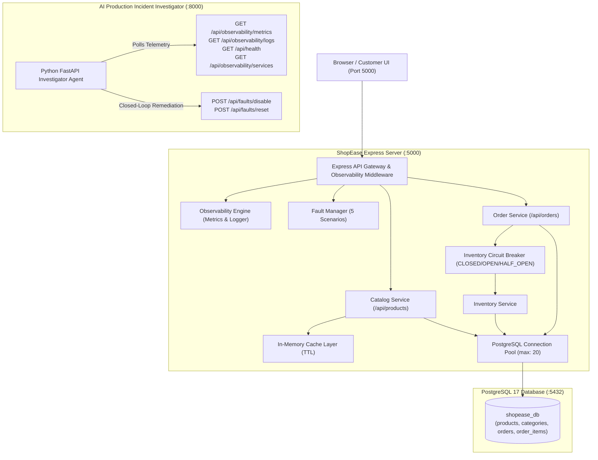
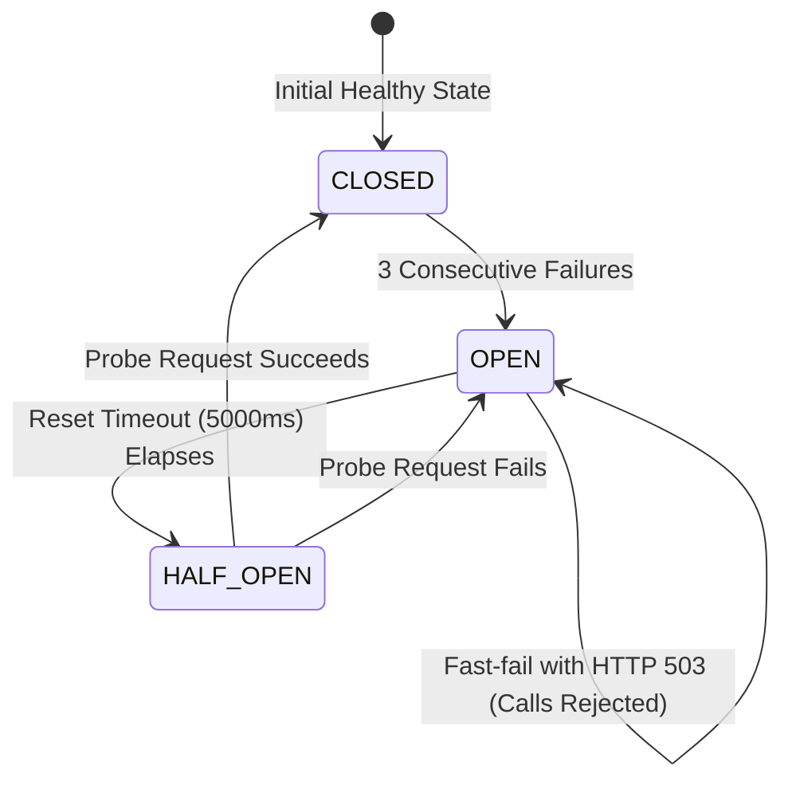

# ShopEase System Architecture & Incident Lab Design

## 1. Executive Summary
ShopEase is designed with an additive, dual-purpose architecture:
1. **Core Indian Lifestyle & Fashion Marketplace:** A customer-facing e-commerce application serving 36 realistic products across six Indian categories with cart, wishlist, and PostgreSQL order placement.
2. **System Reliability Lab & Observability Engine:** A testing ground for chaos engineering and autonomous AI Production Incident Investigation.

---

## 2. High-Level Architecture Diagram

---

## 3. Internal Components & Services

### A. API Gateway & Middleware (`server.js`, `observability/middleware.js`)
- Handles HTTP traffic, static file delivery, and CORS.
- Measures request durations with high-resolution timers (`process.hrtime()`).
- Intercepts artificial delays (High Latency scenario) and forced HTTP 500 errors (Service Error Spike scenario).
- Routes telemetry to the Metrics Tracker and Logger on `res.finish`.

### B. Observability Engine (`observability/metrics.js`, `observability/logger.js`)
- **Metrics Tracker:** Maintains real-time aggregates for requests (total, 2xx, 4xx, 5xx), error rates, moving average latency, max latency, and p95 latency. Integrates live statistics from the PostgreSQL pool, Cache service, and Circuit Breaker.
- **Structured JSON Logger:** In-memory ring buffer (up to 300 entries) recording timestamped logs with severity, originating service, HTTP status, and duration. Automatically redacts customer PII (mobile numbers, street addresses, passwords, emails).

### C. Caching Layer (`services/cacheService.js`)
- Stores category structures and high-traffic product listings with TTL expiration.
- Measures cache hits, misses, total lookups, and hit ratio.
- Features a controlled `isAvailable` toggle for the **Cache Failure** scenario, demonstrating graceful degradation to PostgreSQL queries while surfacing cache failure evidence.

### D. Inventory Service & Circuit Breaker (`services/inventoryService.js`, `services/circuitBreaker.js`)
- Wraps stock verification operations.
- State machine tracks consecutive failures (threshold: 3) and transitions:
  - `CLOSED`: Normal operations pass to the inventory service.
  - `OPEN`: Fast-fails requests with `HTTP 503` without calling downstream dependencies.
  - `HALF_OPEN`: Initiates after `resetTimeout` (5000ms) to probe service health. If successful, resets to `CLOSED`.

### E. Fault Manager (`faults/faultManager.js`)
- Centralized orchestrator managing the 5 fault scenarios:
  1. `db_exhaustion`: Holds pool clients with a 60s auto-release safety timeout.
  2. `high_latency`: Introduces configurable artificial delay on catalogue routes.
  3. `service_error_spike`: Forces target routes (e.g. checkout) to fail with HTTP 500.
  4. `cache_failure`: Disables cache availability.
  5. `circuit_breaker_trip`: Drives the circuit breaker to OPEN via simulated dependency failures.
- Environment safety checks prevent fault injection outside development or test modes.

---

## 4. Database Schema Structure (`shopease_db`)

| Table | Purpose | Primary Columns |
| :--- | :--- | :--- |
| `categories` | 6 lifestyle categories | `id`, `name`, `slug`, `icon`, `description`, `banner_color` |
| `products` | 36 realistic catalogue items | `id`, `name`, `category_id`, `price`, `stock_quantity`, `rating`, `specifications` |
| `orders` | Transactional customer orders | `id`, `order_number`, `customer_name`, `total_amount`, `payment_method`, `order_status` |
| `order_items` | Line items per order | `id`, `order_id`, `product_id`, `quantity`, `unit_price`, `total_price` |

---

## 5. Circuit Breaker State Transition Workflow

